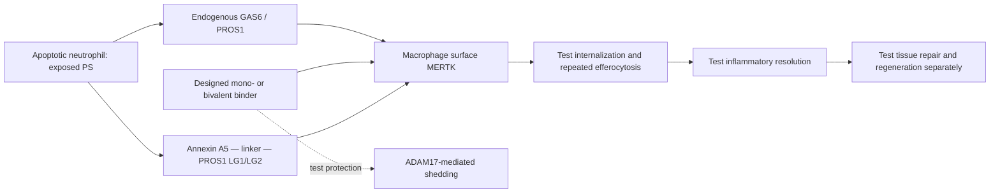

# Engineering MERTK-directed proteins to promote inflammatory resolution

Supporting design rationale | C288 | November 10, 2026

The submission report is [the two-page proposal](repository_archive.md#proposal-drafts). This supporting document is not part of the submission.

## Biological question and central hypothesis

**Can a designed MERTK agonist enhance macrophage clearance of apoptotic neutrophils, accelerate inflammatory resolution, and improve tissue regeneration?**

The immediate goal is a protein that improves MERTK-dependent efferocytosis in human macrophages while maintaining recognition of apoptotic cells. The hypothesis is that productive receptor organization, preservation of surface MERTK during inflammation, or direct bridging of apoptotic cells to MERTK can improve clearance. Resolution and regeneration are successive experimental questions, not consequences that can be inferred from binding or phosphorylation alone.

This is a protein-engineering and immunobiology project using established design tools. Its contribution will be a testable molecular concept, an experimentally grounded epitope rationale, and a mechanism-based comparison of candidates. Computational scores will guide which proteins to test; functional assays will decide which proteins work.

## The problem: preserve the connection between recognition and engulfment

Early apoptotic cells expose phosphatidylserine (PS), a conserved “eat-me” signal. MERTK recognizes this signal indirectly: GAS6 and protein S (PROS1) connect PS-containing membranes to TAM receptors through different ligand domains. PS-dependent presentation therefore matters alongside receptor affinity. GAS6 can activate all three TAM receptors; PROS1 supports MERTK and TYRO3 activation and is not a canonical AXL agonist. [Lew et al., 2014](https://doi.org/10.7554/eLife.03385).

Inflammation can reduce functional surface MERTK through ADAM17-mediated ectodomain shedding. The resulting soluble receptor can also interfere with ligand availability. Cleavage-resistant MERTK has supported improved efferocytosis and resolution in experimental models, motivating receptor protection as a design objective. [Thorp et al., 2011](https://doi.org/10.1074/jbc.M111.263020); [Cai et al., 2016](https://doi.org/10.1073/pnas.1524292113).

However, receptor activation is not enough. A MERTK agonistic antibody impaired efferocytosis in arthritis models despite its agonistic activity. This motivates separate tests of ligand competition, apoptotic-cell recognition, and internalization. [Waterborg et al., 2018](https://doi.org/10.3389/fimmu.2018.00742).

## Two complementary protein concepts

### Concept A: a ligand-compatible MERTK binder with controlled valency

Design compact binders to accessible, relatively MERTK-specific extracellular surfaces. Start with monovalent proteins to establish affinity, epitope, and selectivity. Convert the best two into defined bivalent formats to test whether receptor proximity produces useful signaling and clearance. Compare equal molar concentrations of binding sites as well as equal molecule concentrations, because avidity can otherwise obscure the valency comparison.

The first epitope class will prioritize a ligand-compatible surface outside the presumed GAS6/PROS1 footprint. A second, exploratory class will target the membrane-proximal FNIIIb region as a possible steric barrier to shedding. Neither class is presumed to activate the receptor. A monovalent binder might preserve ligand-driven function without independently being an agonist; a bivalent version might stimulate, block, or accelerate receptor loss. Those are distinct outcomes to classify experimentally.

Use a defined tandem format initially. If an Fc scaffold is later introduced, include matched Fc-only and Fc-silent controls because macrophage Fc receptors can alter uptake independently of MERTK.

### Concept B: an Annexin A5–PROS1-derived apoptotic-cell bridge

This is a required parallel design arm. Replace the natural ligand's PS-binding function with Annexin A5 while retaining a PROS1-derived receptor-binding module. The starting concept is **Annexin A5–linker–PROS1 LG1/LG2 (SHBG-like module)**, with a second construct testing the reversed orientation or a different spacer if the first is sterically unfavorable. Final domain boundaries must be checked against human PROS1 sequence, disulfides, and structural evidence before ordering.

Annexin A5 supplies calcium-dependent PS binding. The native PROS1 Gla-dependent membrane-binding segment is omitted, rather than adding a second PS-binding module to full-length PROS1. Retaining LG1/LG2 is a domain-level hypothesis: it does not establish that the isolated module retains sufficient MERTK affinity, presentation geometry, or signaling activity. Evidence identifying PROS1 LG1 as important for TYRO3 interaction is informative but does not prove MERTK activity of this fusion. [PROS1 domain study](https://pmc.ncbi.nlm.nih.gov/articles/PMC9065593/).

The intended mechanism is target-cell-dependent presentation of the receptor-binding module, potentially promoting productive MERTK organization at the macrophage–apoptotic-neutrophil contact. Test intact fusion against Annexin A5 alone, the PROS1 module alone, their unfused mixture, and full-length PROS1. Include functionally verified PS-binding-defective and receptor-binding-defective controls.

The principal failure mode is PS masking: Annexin A5 could coat apoptotic cells while the receptor-binding module fails to drive engulfment. Engineering Annexin A5 to engage another phagocyte receptor has previously changed its effect on efferocytosis, which supports the general bridging idea, not this particular fusion. [Schutters et al., 2013](https://doi.org/10.1038/cdd.2012.107). Because PROS1 also engages TYRO3, MERTK selectivity is an unresolved requirement for this arm. Competitive occupation of the natural ligand site is expected to be possible; success requires preserved or enhanced net clearance rather than a noncompetition claim.

## Aim 1: choose an experimental reference and defensible epitopes

Use **PDB 37NT**, the human MERTK ectodomain crystal structure released October 7, 2026, at 3.41 Å resolution. It provides an experimentally determined receptor starting structure. The accompanying work describes a curved, glycosylated ectodomain with solution flexibility. Its intermolecular Ig2–FNIIIb crystal contact is a mechanistic lead, not proof of the active receptor assembly. [RCSB 37NT](https://www.rcsb.org/structure/37NT); [Starbird et al., 2026](https://doi.org/10.1042/BCJ20260584).

The downloaded coordinates contain one protein chain with **392 observed residues, author numbering A93–A484**. Preserve the original mmCIF, glycans, sequence mapping, and checksum. The protein-only PDB exported for design omits glycans; it is a computational input, not a complete cell-surface model. Review every candidate in the original glycan-bearing context and ultimately on mammalian cells.

Build an epitope dossier before design: domain placement, solvent exposure, glycan obstruction, ligand overlap, proximity to the membrane, local AXL/TYRO3 conservation, and rationale for linker attachment. Use known TAM–ligand structures, including the [AXL–GAS6 complex, 2C5D](https://www.rcsb.org/structure/2C5D), to inform possible ligand footprints; label transfer to MERTK as an inference. Do not assign a validated MERTK–PROS1 pose from that analogy.

For shedding, distinguish the folded FNIIIb domain from the unresolved juxtamembrane region. The classic cleavage mapping concerns **murine** MERTK near Pro485; that number must not be copied directly onto human MERTK. Align species and experimentally map the human released fragment or relevant stalk sequence. 37NT ends before the complete human stalk and membrane anchor, so it cannot by itself define a cleavage-shielding epitope. Advance the FNIIIb protection hypothesis only if binding reduces shedding without compromising ligand engagement or clearance.

Treat AXL and TYRO3 as explicit negative-design targets. Compare homologous surface patches, seek MERTK-specific interactions, and assess each candidate against all three receptors under matched prediction and binding conditions. Computational failure to predict an off-target complex is not evidence of specificity. The fusion arm must meet the same measured selectivity goal or be described honestly as a broader TAM ligand.

## Aim 2: use established tools to generate a small, diverse candidate panel

Use **BindCraft as the initial practical design route** and **RFD4-Proteina as the independent sequence/structure design comparator**. Both receive the same experimental receptor construct, epitope hypotheses, and binder-length range. BindCraft has published experimental binder validation; RFD4-Proteina offers a current alternative with joint sequence/structure generation. Neither has established superior performance for this MERTK objective. [BindCraft study](https://doi.org/10.1038/s41586-025-09429-6); [RFD4-Proteina repository](https://github.com/RosettaCommons/RFD4-Proteina).

Use **LigandMPNN selectively** when fixed target side-chain context justifies sequence refinement on promising binder backbones. Preserve the original designs, hold receptor sequence fixed, and compare refined versus parent sequences on the same backbone. This is an optional paired follow-up, not an obligatory replacement for either tool's native sequence output. [LigandMPNN implementation](https://github.com/dauparas/LigandMPNN).

Use **AF3 for a common complex-assessment pass**, after generation. AF3 is not the binder sequence generator or the source of the experimental MERTK reference. Assess fold and pose consistency, confidence, clashes, and receptor distortion; then manually review glycans, ligand access, and membrane geometry. These predictions cannot establish affinity, selectivity, agonism, or shedding protection. [AF3 output documentation](https://github.com/google-deepmind/alphafold3/blob/main/docs/output.md).

Start with a fixed compute allowance per method and epitope, retaining attempted, rejected, failed, and accepted counts. Nominate four diverse monovalent candidates per generator for the first expression panel, subject to review; an arm with fewer qualifying designs contributes fewer, without lowering criteria after seeing results. Report design yield per GPU-hour, expression yield, measured binding hit rate, and functional hit rate separately. One target and eight nominated proteins support a pilot comparison, not a universal tool ranking.

## Aim 3: demonstrate mechanism and increased clearance

The primary functional endpoint is **internalized apoptotic-neutrophil cargo per viable human macrophage** in a donor-paired assay. Confirm uptake with imaging or extracellular-signal exclusion; surface adhesion and pH-dependent fluorescence alone are insufficient. Use independent human macrophage donors, standardized neutrophil apoptosis quality, blinded image analysis, and a staged dose/time pilot. The full assay matrix and analysis plan are in [the experiment plan](../docs/experiment_plan.md).

| Question | Experiment and discriminating controls | Evidence needed to advance |
|---|---|---|
| Does it bind MERTK selectively? | SPR/BLI plus cell-surface binding to MERTK, AXL, TYRO3 and receptor-negative cells | Saturable MERTK binding with an acceptable measured off-target margin |
| Does it compete with GAS6 or PROS1? | Sequential/competitive binding with each ligand; cell assays with ligand alone, candidate alone and combinations | Ligand-compatible behavior for Concept A; productive net bridging for Concept B |
| Does valency produce useful organization? | Monovalent versus defined bivalent formats, receptor proximity/clustering readout and phosphorylation time course | Clustering associated with increased clearance, not phosphorylation alone |
| Does it protect surface receptor? | Inflammatory challenge; soluble MERTK, surface MERTK and cell-associated cleavage products | Concordant reduction in shedding and preservation of function, with assay interference excluded |
| Does it cause receptor loss? | Surface/total receptor time course, internalization, recycling and degradation measurements | Sustained or recoverable function on a second apoptotic-cell challenge |
| Is uptake MERTK-dependent? | MERTK loss/blockade, rescue where feasible, receptor-binding-defective control | Candidate benefit attenuated by MERTK disruption and restored with functional receptor |
| Does the fusion recognize apoptotic cells? | PS-positive versus viable cells, PS-containing versus control membranes, module controls | Simultaneous PS and receptor engagement with increased internalization |

Transient receptor internalization may be part of productive signaling; it is not automatically a failure. The concern is persistent depletion or degradation that reduces later clearance. Test whether soluble MERTK sequesters candidates and whether apparent protection merely reflects masking of a detection epitope.

## Aim 4: test resolution before making a regeneration claim

Advance only functionally active candidates into a defined inflammatory macrophage–neutrophil system. Follow residual apoptotic cells, secondary necrosis, inflammatory cytokines, and recovery after the inflammatory stimulus is removed. A temporal reduction in unresolved neutrophils is stronger evidence of resolution than a single low cytokine value. Compare with the same natural-ligand and MERTK-dependence controls.

Use a macrophage-containing human skin wound model as the first tissue extension, preferably a 3D co-culture or explant. Quantify re-epithelialization, barrier restoration, tissue viability, extracellular-matrix organization, and scarring/fibrotic responses. Candidate-only tissue controls distinguish direct epithelial effects from macrophage-mediated benefit. Faster closure alone demonstrates neither full regeneration nor restoration of tissue architecture.

A later in vivo study would require demonstrated activity on the chosen species' receptor or an appropriate humanized model. A sterile resolving-inflammation model can test neutrophil kinetics; a wound model tests repair. True regeneration remains a separate, higher bar requiring restoration of tissue structure and function. Persistent MERTK activity need not be beneficial in every tissue: macrophage MERTK promoted fibrosis in a NASH model. [Cai et al., 2020](https://pmc.ncbi.nlm.nih.gov/articles/PMC7004886/).

## Scope, decisions, and expected deliverables

For the course, deliver the reference/epitope dossier, reproducible tool comparison plan, candidate panel specification, Annexin A5–PROS1 design rationale, and experimental validation package. Expression and donor-based functional studies are the next experimental milestone, subject to laboratory access. Tissue and animal studies are downstream aims rather than promised course outcomes.

A binder that increases phosphorylation but decreases clearance fails. A shedding-protective binder that preserves ligand-driven clearance is useful but is not necessarily an autonomous agonist. A fusion that binds PS but blocks uptake fails. A candidate that improves clearance without protecting against shedding supports a different mechanism and can still advance. Resolution and tissue benefit must each be demonstrated independently.

No designed MERTK candidate, agonist activity, improved efferocytosis, or tissue regeneration has yet been established in this repository. The implemented software prepares and records experiments; the proposal specifies the biological evidence still required.
