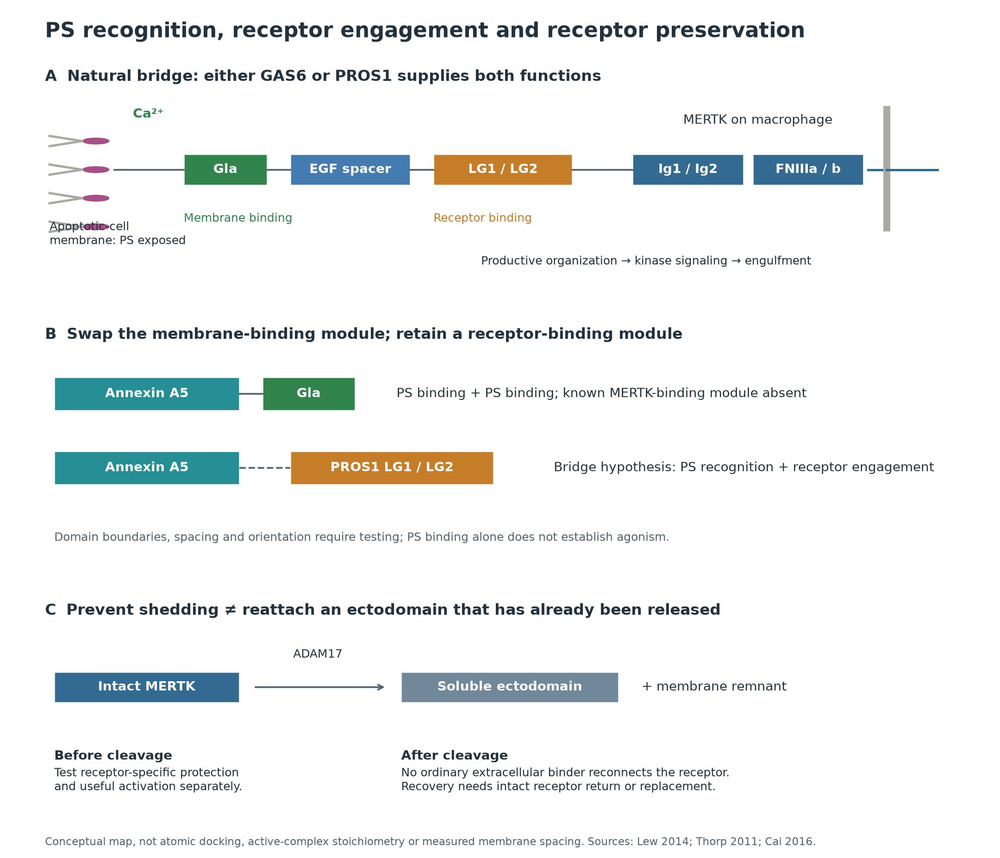
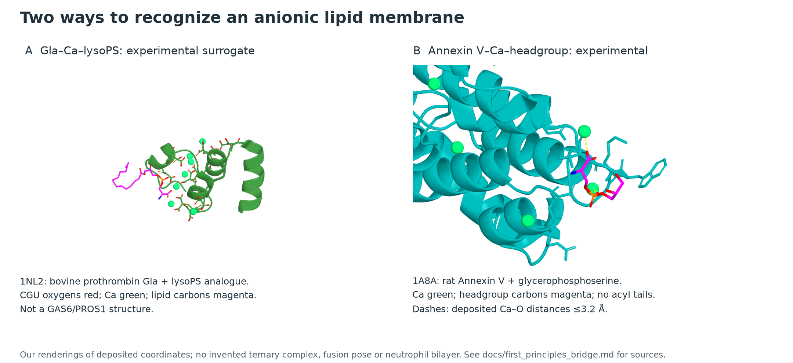

# PS recognition, ligand bridging and MERTK preservation

November 12, 2026. This is a mechanistic reassessment and viewing guide, not a result from our designs. The two-page submission remains separate.



## The natural interaction has two cells and two binding functions

An apoptotic neutrophil presents PS in its outer membrane leaflet. GAS6 **or** PROS1 can bridge that membrane to MERTK on a macrophage. Each ligand contains both functions: its N-terminal, vitamin-K-dependent gamma-carboxylated Gla region binds a PS-containing membrane in a calcium-dependent manner, while its C-terminal laminin G-like (LG/SHBG) region engages TAM receptors. EGF-like repeats connect these regions. MERTK's extracellular Ig region is the natural-ligand-recognition region; its intracellular kinase and engulfment machinery belong to the macrophage. PS is a lipid, not a receptor or a protein uniquely encoded by neutrophils. Lipid acyl species, exposure, density and membrane context can vary.

Binding and signaling are separate. In the primary study by [Lew et al. (2014)](https://doi.org/10.7554/eLife.03385), Gla deletion weakened GAS6's Mer/Tyro3 agonism and eliminated Axl agonism despite preserved Axl binding. Thus, the LG module is not a guarantee of productive signaling, and receptor phosphorylation is not a guarantee of cargo engulfment. Both GAS6 and PROS1 can activate Mer and Tyro3; PROS1 is not an AXL agonist in that study. A PROS1-derived fusion must still be tested against TYRO3.

## What we can actually view

The new local bundle is `outputs/pymol/bridge_review_20261112/`, copied to `~/Downloads/MERTK_Bridge_Review_2026-11-12/`. Open `Open_in_PyMOL.command` there. Coordinates, a portable `.pse` session, scene PNGs, a source/hash manifest and measured Ca–lipid contacts are included. Molecules in the overview are separated and independently oriented for display. They are not an assembled or docked intercellular bridge.

| Viewing scene | What is shown | What it cannot establish |
|---|---|---|
| `01_separate_components` | Experimental MERTK and human Annexin V; predicted full human GAS6/PROS1; ideal PS chemical example, at a common coordinate scale | A bound pose, physiological intercellular distance or receptor stoichiometry |
| `02_GAS6_domains`, `03_PROS1_domains` | Gla green, EGF blue, LG1 orange, LG2 yellow-orange | Native Gla gamma-carboxylation, bound calcium or a membrane: these are absent from the predicted monomers |
| `04_Gla_lysoPS`, `05_Gla_contact_detail` | Experimental [1NL2](https://www.rcsb.org/structure/1NL2): bovine prothrombin Gla region, deposited gamma-carboxyglutamate (CGU), seven calcium ions, lysoPS analogue | A GAS6/PROS1-specific interface, full diacyl PS or a neutrophil bilayer |
| `06_Annexin_headgroup`, `07_Annexin_contact_detail` | Experimental [1A8A](https://www.rcsb.org/structure/1A8A): rat Annexin V, calcium and glycerophosphoserine | Human fusion activity or acyl-tail/membrane packing |
| `08_human_Annexin` | Experimental human Annexin V [1ANX](https://www.rcsb.org/structure/1ANX), calcium-bound chain A | A lipid-bound or MERTK-bound complex |
| `09_receptor_binding_analogy` | Experimental [2C5D](https://www.rcsb.org/structure/2C5D), GAS6 LG region with AXL Ig domains | An experimental MERTK–GAS6 or MERTK–PROS1 pose |
| `10_MERTK_proposed_patches` | Experimental [37NT](https://www.rcsb.org/structure/37NT); proposed FNIII anchors magenta and observed glycans gold | The unresolved cleavage segment, membrane or kinase; agonism by either patch |
| `11_PS_chemical_model` | CCD [P5S](https://www.rcsb.org/ligand/P5S), ideal distearoyl PS (18:0/18:0) | A PS species measured in our neutrophils, an experimental conformer or a bilayer |
| `12_fusion_modules_separate` | Human Annexin A5 and the predicted PROS1 LG region as separate components | Any linker geometry, fused structure, receptor activity or retained function |

We have not supplied a solved, complete PS–GAS6/PROS1–MERTK complex. The two experimental lipid examples are deliberately partial evidence. They let us inspect the physical chemistry without substituting a homology model for an experiment.



The Gla example comes from [Huang et al. (2003)](https://doi.org/10.1038/nsb971); the Annexin example from [Swairjo et al. (1995)](https://doi.org/10.1038/nsb1195-968). We rendered deposited coordinates, retaining native local geometry. Dashes in the close-up scenes report Ca–lipid-oxygen separations at or below 3.2 Å; they are geometric contacts, not a complete coordination or bond-valence analysis. There are two such contacts in each example (`deposited_Ca_lipid_contacts.csv`). The Gla surrogate preserves ten deposited CGU residues. It should not be relabeled GAS6 or PROS1.

## Which Annexin fusion makes mechanistic sense?

**Annexin V and Annexin A5 are the same protein name in this context.** Annexin A5 already recognizes PS-containing membranes through calcium-dependent interactions. It is not a Gla domain and does not require vitamin-K-dependent gamma-carboxylation to supply that function.

| Construct idea | Functions supplied | Interpretation |
|---|---|---|
| Annexin A5–Gla | Two membrane-recognition modules | Lacks the known TAM receptor-binding LG module. There is no established direct MERTK-activation mechanism for this fusion. It could instead compete for PS or change membrane organization. |
| Annexin A5–PROS1-derived LG1/LG2 | Membrane recognition plus a candidate TAM receptor-binding module | The relevant modular replacement hypothesis: substitute Annexin for the native Gla-dependent membrane-binding end while retaining a receptor-binding end. Retained folding, receptor affinity, orientation and activation remain to be demonstrated. |
| Annexin A5–designed MERTK binder | Membrane recognition plus an engineered receptor-binding end | An alternative if the isolated PROS1 module is inactive or insufficiently selective. The designed binder must still produce useful signaling/uptake. |
| Ligand-compatible FNIII binder alone | Receptor occupancy; perhaps protection or organization | It provides no PS recognition by itself. Any improvement in corpse clearance may still depend on endogenous bridging ligands and other recognition systems. |

The first fusion should not be promoted as a MERTK agonist simply because it binds apoptotic cells. The second is a sensible hypothesis, not an already validated design. Natural interdomain spacing can matter, so boundaries and linkers should be tested rather than chosen solely to minimize size. See the [proposal](repository_archive.md#proposal-drafts) for module and unfused-mixture controls. PROS1-derived material also needs evaluation for activities beyond MERTK; removing one module does not establish that all other biological effects disappear.

Free Annexin A5 can mask PS and compete with native recognition; Lew et al. used it to inhibit ligand-supported signaling in their experimental system. Therefore, successful coating of apoptotic neutrophils could coexist with *worse* clearance. The decisive endpoint is MERTK-dependent **internalized** neutrophil cargo, with preserved viability and repeated uptake, rather than the amount of fusion bound to the dying cell.

## Shedding: protect an intact receptor versus recover after cleavage

[Thorp et al. (2011)](https://doi.org/10.1074/jbc.M111.263020) mapped ADAM17-dependent cleavage to the region of mouse Mertk P485. Deleting a six-residue segment spanning that position conferred cleavage resistance. Our canonical sequence alignment maps mouse P485 to human P490; that is an alignment correspondence, **not** direct evidence of the human cleavage bond. Human 37NT ends at observed G484, so it does not provide coordinates for this corresponding segment. We should replace the vague idea that cleavage is wholly unmapped with this species-specific evidence and its structural limitation.

Once the ectodomain is released, these ordinary extracellular binders cannot rejoin it to the membrane/kinase remnant. The soluble fragment can act as a ligand sink: [Sather et al.](https://pmc.ncbi.nlm.nih.gov/articles/PMC1785151/) showed soluble Mer binding GAS6 and inhibiting receptor activation and apoptotic-cell clearance. We must distinguish three objectives:

1. **Protect before cleavage.** A receptor-specific binder might sterically hinder protease access or stabilize a less-cleavable conformation while leaving physiological recognition possible. This requires cleavage-region/context evidence and actual protection measurements; FNIII occupancy alone proves neither mechanism. General ADAM17 perturbation is a mechanistic comparator with many substrates, not evidence that a MERTK binder is selective.
2. **Activate the intact receptors that remain.** A bridge or appropriately organized binder may signal through residual full-length MERTK. It cannot compensate if too little intact receptor is present. Activation may also accelerate internalization and receptor loss.
3. **Restore intact surface receptor after loss.** Recovery requires replenishment from newly synthesized receptor or an intact intracellular receptor pool. Cleavage-resistant Mertk is a useful causal control, supported by [Cai et al. (2016)](https://doi.org/10.1073/pnas.1524292113); it is not repair of a previously cleaved molecule. Our extracellular protein-design project does not currently implement receptor replacement.

The receptor-trafficking study by [Lahey et al. (2024)](https://doi.org/10.3390/ijms25084404) further separates shedding/fragment processing from ligand-associated internalization and lysosomal degradation in its cell models. A fall in soluble MERTK alone can reflect receptor depletion rather than protection. Pair it with surface and total receptor, cleavage products and uptake over time.

Both proposed FNIII patches are on the ectodomain expected to be released in the mapped cleavage scenario. Binding to soluble ectodomain may therefore sequester a designed binder as well as native ligand; intact-versus-soluble receptor binding and a soluble-MERTK challenge are useful tests. This is a predicted concern to test, not a measured property of our candidates.

## Could Patch A or Patch B nevertheless activate MERTK?

**Possibly, but no structural or experimental result here establishes it.** A binder can be neutral, antagonistic, protective, independently agonistic or ligand-dependent. Productive receptor proximity/orientation is a property of the entire receptor–binder assembly, including valency and membrane geometry. A monovalent binder is not automatically an agonist; neither is every bivalent binder. A molecule that binds A and B on the *same* receptor may simply engage one receptor twice rather than bring two receptors together.

Patch A (I365/W367/A369) and Patch B (R460/P471/F472) remain exploratory binding surfaces. For A, full-footprint glycan access is unresolved. For B, being in FNIIIb does not establish cleavage protection or a productive oligomer. Neither is the natural ligand-recognition module. Being distant from the canonical ligand site also does not prove functional compatibility. The [existing assessment](repository_archive.md#proposal-drafts) records the measured local exposure, glycan proximity and approximate species/paralogue mapping.

The warning is empirical: [Waterborg et al. (2018)](https://doi.org/10.3389/fimmu.2018.00742) found that a MER-activating antibody interfered with efferocytosis and worsened experimental arthritis. This does not rule out agonistic binders generally; it rules out treating phosphorylation as the success criterion.

## A smaller set of decisions before more generation

Start by comparing native, appropriately processed GAS6 and PROS1 as biological benchmarks. Ask whether the dominant limitation under the inflammatory condition is ligand bridging, loss of intact receptor, or a later engulfment step. Build a PS-versus-control-membrane and apoptotic-versus-viable-cell recognition comparison for the fusion modules. Then establish human/mouse receptor engagement, AXL/TYRO3 discrimination and ligand compatibility before committing to valency variants.

Evaluate each binder as monovalent and, for binding hits, a defined bivalent variant, with and without each endogenous ligand. Measure receptor organization/phosphorylation alongside MERTK-dependent internalized cargo, surface retention and a second uptake challenge. Separately test inflammatory shedding and challenge with soluble ectodomain. These comparisons distinguish a PS bridge, a receptor agonist, and a receptor-protective adjunct. They may justify different molecules instead of requiring one molecule to solve all three problems.

No new GPU generation jobs were submitted for this reassessment. The next computational target is a defensible receptor/epitope/valency specification, not a presumption that either FNIII patch is already agonistic.

## Reproduction and provenance

```bash
.venv/bin/python scripts/prepare_bridge_review.py --output outputs/pymol/bridge_review_20261112
# Use the Python environment that provides pymol2:
/opt/homebrew/opt/python@3.14/bin/python3.14 scripts/build_bridge_review.py outputs/pymol/bridge_review_20261112
.venv/bin/python scripts/draw_bridge_mechanism.py
```

Preparation reuses the previously downloaded human 37NT and full GAS6/PROS1 references and fetches 1NL2, 1A8A, 1ANX and the ideal P5S component. `sources.json` records the original coordinate URLs and SHA256 hashes. No model weights or new protein predictions are needed. Figures are our renderings/schematics, not copied paper figure panels. The synthetic layout of separate components does not alter the geometry within the experimental lipid complexes.
